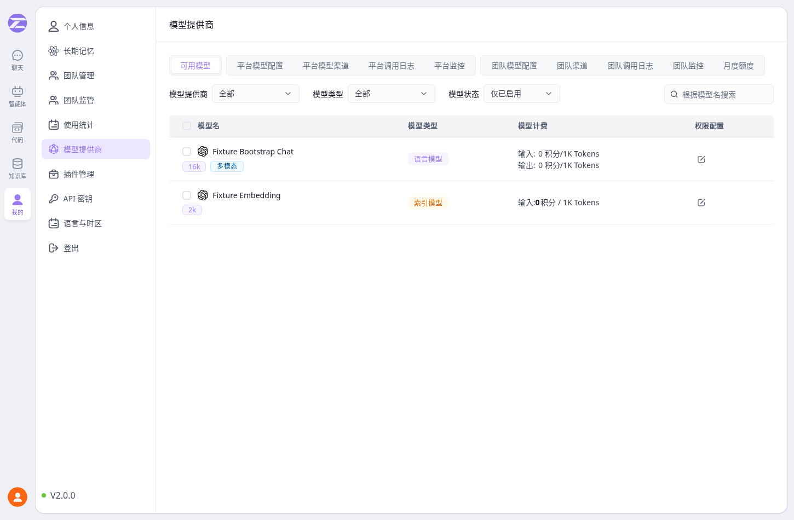

打开「我的 → 模型提供商」。普通成员的「可用模型」用于查看当前能选用的模型。团队所有者和团队管理员还可管理当前团队的模型、渠道、日志和月度额度。root 有平台模型配置入口；平台渠道、日志和监控入口随部署启用的模型网关显示。

## 平台模型与团队绑定

1. root 在「平台模型配置」选择模型类型，填模型标识、显示名称和该类型的必要参数。启用平台模型渠道时，核对渠道配置及模型映射。
2. 切换到目标团队，在「团队模型配置」检查所需的平台模型及连接方式。需要团队单独配置连接时，按页面选择已有渠道或填独立 API 基础地址和密钥。
3. 保存后执行该模型支持的测试。按模型类型验证业务入口，例如聊天使用语言模型，知识库训练使用向量模型，重排使用配置的重排模型。
4. 查看默认模型设置。更换默认值后，从实际使用入口发起新任务验证；已有工作流和知识库的显式选择要逐一核对。

平台已启用模型会提供默认团队绑定。团队可用显式配置覆盖默认连接或停用该模型，成员仍按模型协作者规则取得使用权限。

## 团队自建模型与渠道

1. 在当前团队的「团队渠道」创建渠道，填写团队环境能访问的 API 基础地址和凭据，检查启用状态。
2. 打开「团队模型配置」，按模型类型新增模型。把模型接到已配置的团队渠道，或按界面使用独立连接信息。
3. 先做连通性测试，再用该团队的普通成员账号执行一条业务请求。到「团队调用日志」核对时间、模型、渠道和结果，在「团队监控」看汇总。
4. 删除或停用模型前，查看应用、默认槽位及后台任务是否在用。先选替代模型，保存并验证后再停用旧模型。

## 模型权限与额度

管理员在「可用模型」中找到目标模型，打开权限操作，为个人、部门或群组配置协作者。没有协作者规则时，符合团队配置和启用条件的模型默认可用；设置协作者后，普通成员需匹配授权，个人配置优先。删除最后一条协作者规则会恢复团队默认可用，限制访问时先核对保留的规则。

在「月度额度」检查个人、部门、群组或团队的额度配置。保存后用成员账号提交一条实际请求，检查用量和额度提示。额度、模型授权、渠道连通性要分别验证。

## 常见问题

- **测试成功，但成员看不到模型。** 核对当前团队、模型启用状态、团队绑定、协作者配置，以及当前入口需要的模型类型。
- **候选列表看不到停用模型。** 管理者在可用模型的状态筛选中选择「全部状态」，排查配置或为重新启用预设权限。
- **连接失败。** 先核对目标渠道、API 基础地址、模型标识和密钥。使用部署服务器可访问的地址，查看团队调用日志的结果定位问题。
