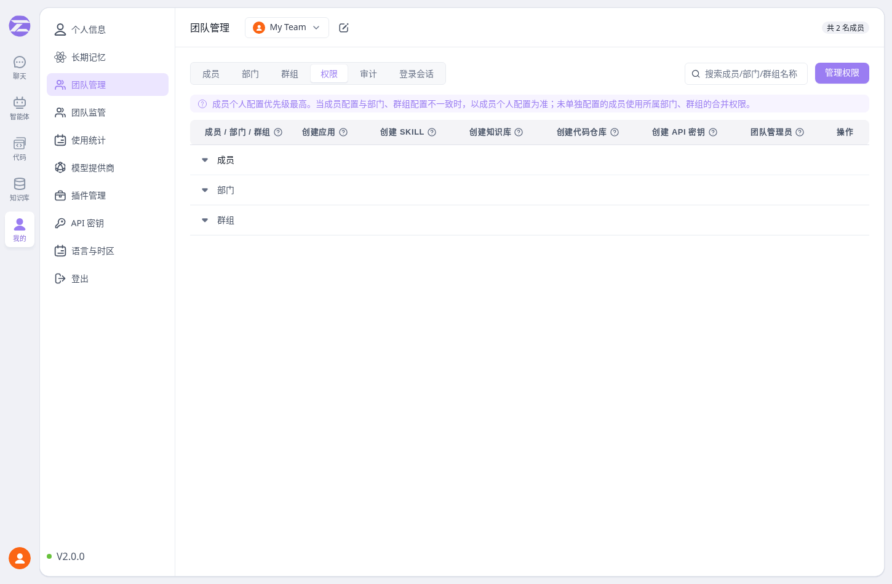

## 角色矩阵

| 操作 | 平台管理员（root） | 团队所有者 | 团队管理员 | 普通成员 |
| --- | --- | --- | --- | --- |
| 查看全平台团队和生命周期 | 团队监管 | — | — | — |
| 管理本团队普通成员、部门、群组 | 进入目标团队后操作 | 可以 | 可以，受管理员范围保护 | 通过团队管理员办理 |
| 任免团队管理员、调整管理员授权范围 | 进入目标团队后操作 | 可以 | 由所有者或 root 操作 | 由所有者或 root 操作 |
| 转让当前团队所有权 | 监管身份按团队角色判断 | 由当前所有者发起 | 由当前所有者发起 | 由当前所有者发起 |
| 平台模型目录和平台渠道 | 管理 | 使用团队已配置的模型 | 使用团队已配置的模型 | 使用授权模型 |
| 本团队模型、额度和使用统计 | 进入目标团队操作 | 管理 | 管理 | 查看可用模型 |

团队所有者随所有权取得管理权限。资源所有者随单个资源变化。同一个人在其他团队可以是普通成员。实际执行以当前团队、资源权限及产品配置为准。

## 分配团队权限

1. 切换到目标团队，打开「我的 → 团队管理 → 权限 → 管理权限」。
2. 找到成员、部门或群组。批量分配通用权限时先选部门或群组；有例外时再查成员个人设置。
3. 核对「创建应用」「创建知识库」「创建代码仓库」「创建 Skill」「创建 API 密钥」和「团队管理员」。团队管理员包含五项创建权限。权限页以个人设置优先，未单独设置的成员使用所属部门和群组的合并权限。
4. 保存后，用目标成员账号回到团队验证。例如只给某成员开通创建代码仓库，再确认该账号在「代码」根目录能创建，应用、知识库等按钮仍按原授权显示。

## 分配资源权限

由平台管理员、团队所有者或团队管理员处理。分配时还会检查操作者对该资源的有效权限。普通成员的资源角色可用于日常查看和编辑；如需调整协作者，请联系团队管理者。

1. 从智能体、知识库、代码仓库或 Skill 的列表或详情找到目标资源，点击「权限」。先确认目标是具体资源还是上级文件夹。
2. 添加成员、部门或群组，按场景选允许的角色。例如让评审人员查看材料，让维护者编辑，对权限负责人授予管理。
3. 检查页面上的继承状态和协作者。在继承目录权限时，先评估改上级目录会影响的资源；单独调整某资源后，如需重新与上级同步，用「恢复继承」入口。
4. 保存后用目标成员账号验证读、编辑、管理三个操作；有目录路径时同时检查能否顺着目录找到目标资源。

资源的「目录访问」可以让成员到达已授权资源。检查资源本身的授权来判断能否查看旁边的内容或在目录中创建。根目录的创建权在团队权限页设置，文件夹内创建还要符合目标目录权限。配置智能体时另外检查其引用的知识库、代码仓库和模型能否访问。

## 常见问题

- **成员同时属于多个群组，实际权限和预期不同。** 优先找该成员有没有个人设置，再对照匹配的部门和群组。
- **给了文件访问权，仍不能新增文件。** 文件夹内创建受所在目录写权限控制，读权限只支持查看已授权内容。
- **能编辑应用，仍找不到日志或授权入口。** 查看该应用的权限细项。日志和管理操作有自己的权限条件。
