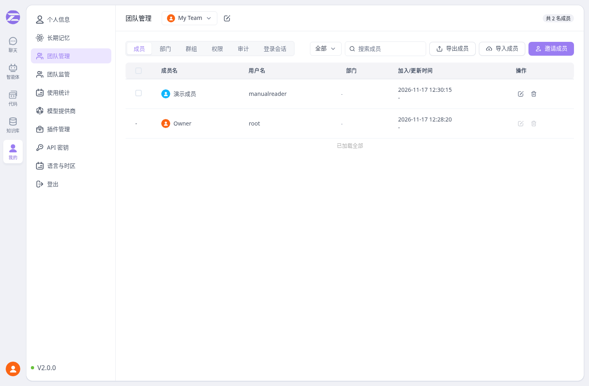
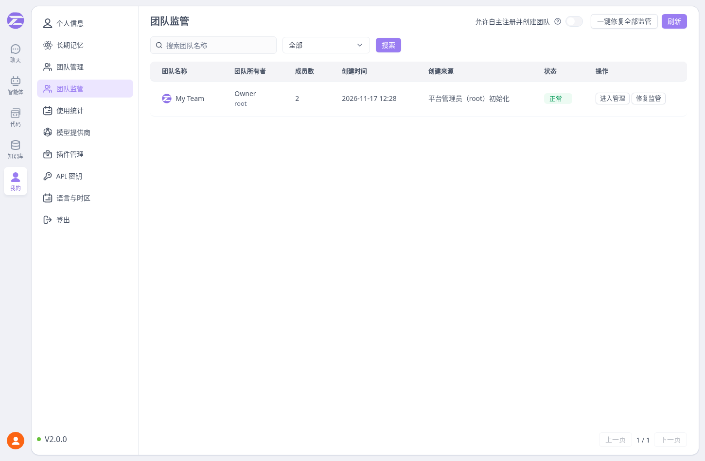

## 切换到要操作的团队

每位使用者使用自己的账号。同一账号加入多个团队后，在「我的 → 个人信息」或「团队管理」顶部切换团队。切换后先核对团队名称，再查看资源、分配权限或导出统计。团队所有者和团队管理员的权限都随当前团队变化。

## 添加成员

1. 团队管理员打开「我的 → 团队管理 → 成员」，点击「邀请成员」，按对话框提示生成邀请并发给对应人员。
2. 邀请对象使用本人账号完成加入。管理员回到成员页刷新，确认成员状态及部门。
3. 批量开户时使用「导入成员 → 下载 CSV 模板」。按模板填写用户名、初始密码、成员名、部门路径和群组名。多个部门或群组用英文分号分隔。用户名不区分大小写；导入表单要求英文字母。密码为 8～15 位，至少含大小写英文字母和数字。
4. 导入后核对成功和失败条数，按失败行提示修正。初始密码单独交给对应人员；导入完成后妥善处理含密码的本地 CSV。

## 部门与群组

在「部门」创建组织树和子部门，通过部门操作管理成员。把需要跨部门协作的成员加入共同的「群组」。例如按机构设置「研发部」，为某次项目另建「项目评审组」。授予多人同样权限时可使用部门或群组；个别例外再到[权限](./permissions.mdx)单独设置。

## 移出、恢复与审计

- **移出**用于暂停成员在当前团队的访问。需要重新授权前先查看「已移出」状态，可恢复有保留的成员身份、资源和权限。
- **正式删除**按对话框处理成员拥有的资源，先核对资源清单和接收人。需要临时停用时选择移出。
- 「审计」用于回看团队操作。「登录会话」用于检查会话时间和状态，按权限强退异常会话。成员改密和移出后，提醒当事人重新登录或切换团队。

## 平台管理员入口

平台管理员（root）可打开「我的 → 团队监管」。找到目标团队后通过「进入管理」切到该团队，操作前核对当前团队。冻结、解冻和发起删除在监管页操作。删除前按页面流程核对确认人、冷静期和资源处置。团队监管身份与团队所有者是两种身份。

需要由各单位负责人自行开户并创建团队时，平台管理员可按计划开启「允许自主注册并创建团队」。注册人是所建团队的所有者。开户完成后回到监管页复核团队及所有者，并根据现场管理要求关闭自主注册。

## 常见问题

- **邀请已完成，仍看不到应用或仓库。** 先核对当前团队，然后由资源管理员核对个人、部门或群组授权。
- **看得到成员但无法调整管理员或含管理员的部门。** 请团队所有者或平台管理员处理，管理员角色的继承范围也受保护。
- **误移出同事。** 在成员筛选中选择「已移出」，找到原成员并按提示恢复。正式删除后的资源处理以当时的确认结果为准。

## 新团队交接清单

1. 平台管理员核对团队及所有者，明确谁负责监管、谁日常管理。进入管理页后看清当前团队再操作。
2. 所有者给需要管理成员的同事分配团队管理员角色。日常资料维护者按职责授予创建或资源权限。
3. 广泛适用的权限交给部门或群组，少数例外用个人项。管理员权限范围调整后复核继承关系。
4. 用普通成员完成一次真实访问，检查可见资源、可用模型和发布入口。交接时记录团队、操作角色和验收时间。
