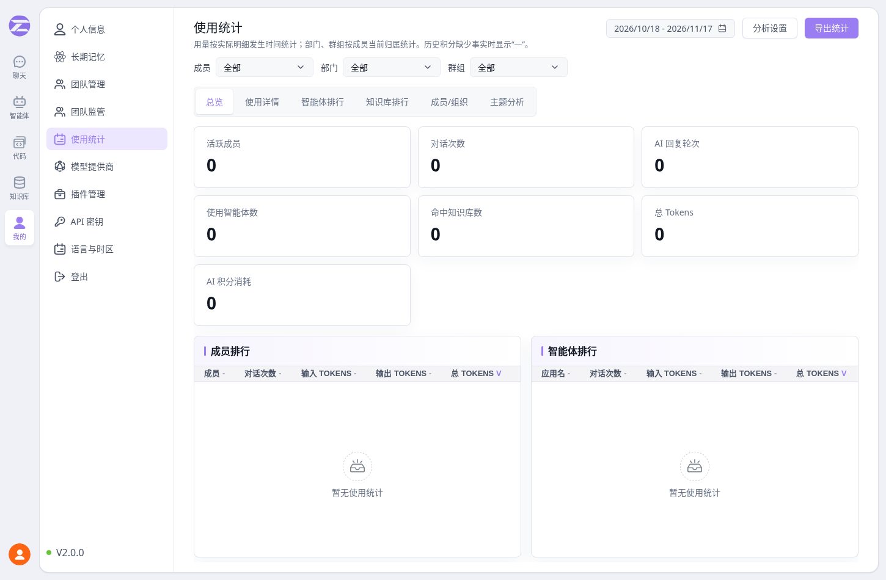

团队所有者或管理员进入「我的 → 使用统计」。先确认当前团队，再选择日期范围。需要定位某个部门或成员时，在页首选择成员、部门和群组。

## 查看与核对

1. 在「总览」查看活跃成员、对话次数、AI 回复轮次、命中知识库数、总 Tokens 和 AI 积分消耗。对账时先确认比较的是同一指标，例如一次对话可包含多轮回复。
2. 在「使用详情」按时间和来源定位具体记录，对照执行的应用或功能，以及输入、输出 Tokens 和消耗。
3. 用「智能体排行」「知识库排行」「成员/组织」查看分布。核对某项排名时保留同一筛选条件，再回详情确认组成记录。
4. 「主题分析」用于查看主题和标签。root 可在「分析设置」检查启用状态与分析模型；分析结果生成时间可能晚于源用量记录。

## 统计口径与导出

- 用量按实际使用明细的发生时间统计。部门和群组按成员当前归属汇总，归属变更可能改变组织维度的统计结果。
- 历史记录缺少积分事实时显示「—」。对账时保留这个缺失标记。
- 「导出统计」按当前筛选导出 CSV，包含使用明细及对应的主题分析记录。按「记录类型」筛开再汇总，避免把主题记录混入用量明细。
- 模型提供商的调用日志用于排查模型连接和调用结果。与使用统计对照时，先对齐范围、时间和来源。

## 常见问题

- **同事看不到统计入口。** 检查其对当前团队是否拥有管理权限。
- **导出结果和屏幕看到的不一致。** 核对团队、日期、成员、部门、群组及记录类型；导出包含当前筛选命中的明细及主题，不限于当前浏览页。
- **模型已有调用，统计里没有对应记录。** 核对调用归属的团队、发生时间和来源，并查看使用明细。历史缺少的数值按缺失处理。

## 对账示例

同一位演示成员收到两轮 AI 回复，期间模型请求也可能分多次。先在「使用详情」以时间和来源找到明细，核对输入、输出 Tokens 与当时记账的积分。然后用「总览」看对话次数和 AI 回复轮次，用「成员/组织」看归属，用调用日志排查重试、错误或模型渠道。模型请求数、AI 回复轮次和会话数对应不同的统计对象。

- **知识库排行**：同一回复多次引用同一库时，回复次数按该回复和该库核对。涉及多个库时，先按实际命中范围检查分摊，再使用单库筛选比较。
- **模型调价或重命名后**：历史实际积分按发生时记录核对。零积分模型仍可能有 Token；有缺失标记的历史数据单独保留。
- **导出复核**：记下日期和筛选条件，在 CSV 按「记录类型」区分使用明细与主题记录，再核对来源、时间、成员及汇总单位。
