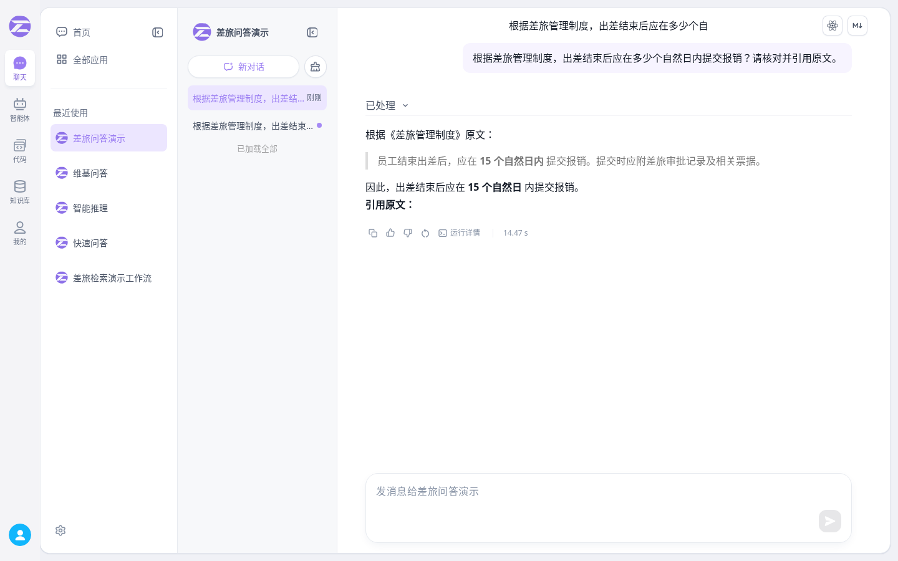

## 配置与发布

1. 在「智能体」打开已有或新建对话 Agent。选当前团队可用的语言模型。
2. 在编辑页的知识库配置添加需要搜索的库。选定范围后打开检索参数，对照同一个库的[检索测试](../dataset/search-test.mdx)，保留用于验收的参数。
3. 写清回答约束，例如「先按制度引用回答；找不到依据请说明缺少哪部分资料」。需要使用附件时核对输入配置和模型能力。
4. 在调试区分别问一条能命中、一条缺资料、一条涉及权限的题。逐条打开引用核对。保存并发布后，用目标成员从「聊天」再试，确认实际打开的是已发布版本。
5. 比较不同角色时检查团队与资源范围。应用可见、资料可查、模型可用各有权限条件。

## 在正式聊天中复核

绑定已经在搜索测试命中的差旅资料库，保存和发布。打开「聊天」并选择「差旅问答演示」新建对话，问「根据差旅管理制度，出差结束后应在多少个自然日内提交报销？」。核对答复里的「15 个自然日」。有引用时打开它核对 `差旅演示.txt`。只有文字摘录时，打开「运行详情」检查实际执行了哪些检索工具，回到知识库核对来源。

## 与工作流和场景预设配合

希望在检索结果为空、出错或条件匹配时走不同分支，用[工作流](./workflow/index.mdx)明确连线。需要开箱使用的检索策略时，到[场景智能体](./scenarios.mdx)选择合适预设。套用模板后重新确认绑定库和用户可见范围。

## 常见问题

- **同一个问题，检索测试有命中，Agent 回复却无引用**：检查编辑页绑定、正式发布版本、检索设置、账号权限和执行详情里的实际检索结果。
- **引用来源正确但最终回答没有吻合**：检查内容预算、提示词和模型适用场景。用少量可核对的题先复现。
