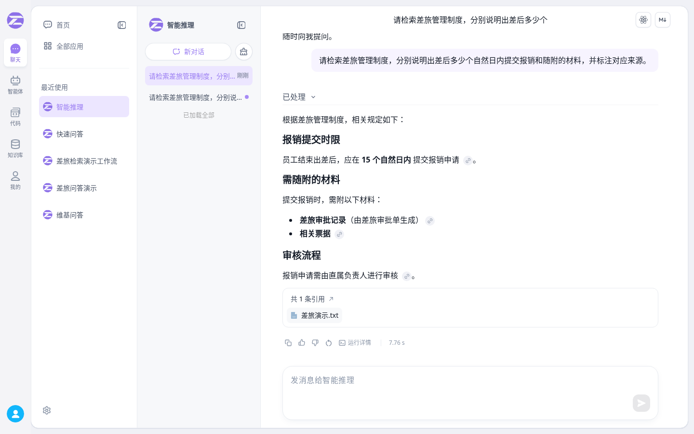
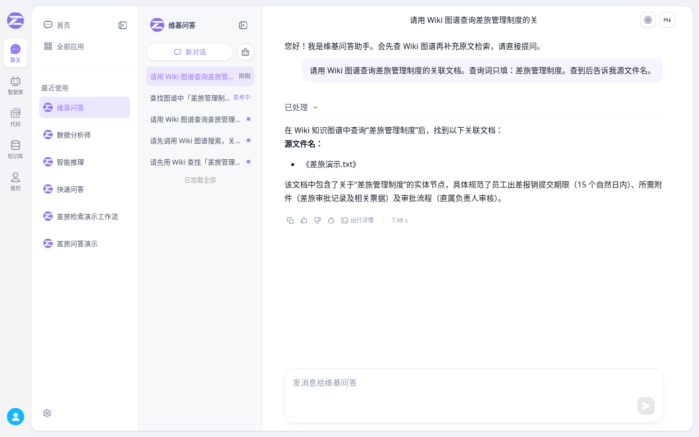
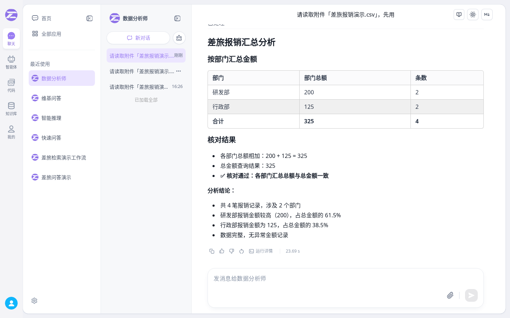

在「智能体」打开创建页，在场景智能体区域选择预设。快速问答、智能推理和维基问答在创建或保存时需要绑定至少一个知识库。选择模型后，按现场授权完成配置和调试。


| 预设 | 准备材料 | 建议先验证 |
| --- | --- | --- |
| 快速问答 | 处理完成、可检索的客服手册或制度库 | 用已知问答确认命中文本和引用，再问一条资料外问题 |
| 智能推理 | 存放相关不同文件或章节的知识库 | 问同时涉及两个条款的问题，核对是否分别找到和引用依据。根据源文处理冲突 |
| 维基问答 | 有可核对的 Wiki 条目及原文证据的知识库 | 用概念、别名和相关概念追问，打开引用落回正文，检查条目和来源版本 |
| 数据分析师 | 会话中上传的 CSV 或 Excel；按部署情况启用相关能力 | 看列名、类型、统计条件和合计数；与源表做小样本核对 |

## 四类示例

- **快速问答**：问「出差结束后多久提交报销？」。先看命中片段的期限，再核对答案。
- **智能推理**：将申请流程和报销规则放在两份文档里，问「报销需要哪些前置材料，有什么截止时间？」。检查各条结论分别引用对应文件。
- **维基问答**：在[知识库 Wiki](../dataset/wiki.mdx)完成小样本提取后，问「差旅审批属于哪些流程，和报销材料怎么关联？」。核对关系及对应证据，看到证据失效时先处理资料。
- **数据分析师**：上传演示报销表，问「按部门汇总金额，另列空值行数」。先确认列名、单位和过滤条件，再从少量明细核对合计。数据分析师以表格为输入，创建时无需为它绑定知识库。

## 用可核对的样例跑一轮

1. **快速问答**：绑定已训练的差旅库，问「根据差旅管理制度，出差结束后应在多少个自然日内提交报销？」。核对答复中的「15 个自然日」，检查检索结果的源文件。
2. **智能推理**：在相同样例上继续问期限和随附材料，逐项核对「差旅审批记录」「相关票据」和引用。使用跨文件问题时，每条规则都要对应到实际来源。
3. **维基问答**：先在知识库 Wiki 页面确认「差旅管理制度」有原文证据。提问时给出条目的完整名称。运行详情应显示图谱工具收到查询词并返回相关节点。若提示「图谱查询词不能为空」，检查所选模型的工具调用能力后重试。普通原文检索仍可能回答这道题，验收图谱时还要看图谱调用结果。
4. **数据分析师**：上传下面的 CSV。要求按部门汇总并给出总金额。核对研发部 200、行政部 125、全表 325。打开运行详情确认「表格结构嗅探」和「内存SQL数据分析」是否成功。用中文列名时，SQL 中给列名加双引号，使用英文逗号分隔字段。

```csv
部门,金额
研发部,120
研发部,80
行政部,50
行政部,75
```








图谱调用一直收到空查询词时，可请交付方检查该工具是否声明了查询参数。遇到表格分析工具加载失败，在运行详情确认失败原因。使用虚拟机计算时仍需核对原始数据和实际工具输出。

## 发布前检查

用目标成员账号走正式聊天入口，确认预设可见、模型可用、引用或表格可打开。上游资料变化后先更新资料和索引，再对照同一组问题重新验证。
