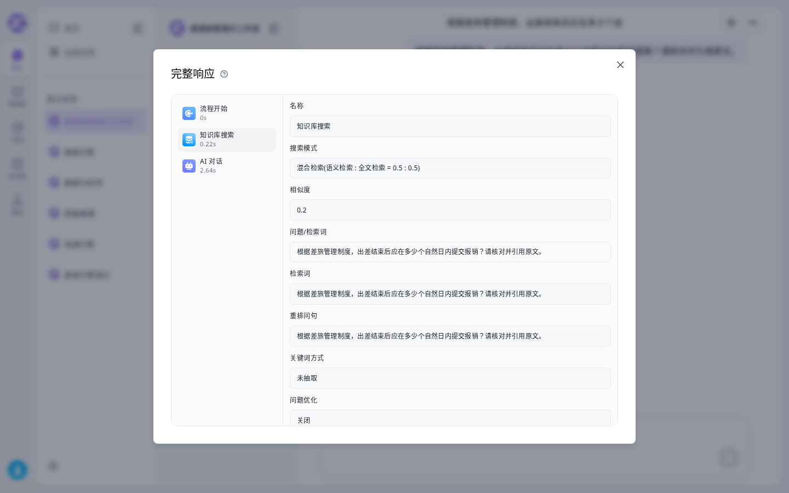

1. 在「智能体」新建工作流。添加「知识库搜索」和「AI 对话」。
2. 将开始节点连到知识库搜索，再连到 AI 对话。搜索内容引用开始节点的用户问题。
3. 在 AI 对话填写提示词，用户问题引用开始节点，知识库引用选择搜索节点的「知识库引用」输出。
4. 调试时先检查搜索输出，再看回答。资料找不到时，搜索的空引用可以流向条件判断或指定回复；上游模型和服务故障按节点错误信息处理。
5. 保存、发布，再用目标账号从正式入口运行。

节点表单中的输入决定当前节点接收什么，输出用于下游变量选择器。连线决定执行路径。配置前后可分别查看节点调试结果和全流程结果。点击节点右上角的书本可查看对应教程。

## 核对实际执行路径

发布后，从「聊天」打开工作流，提问「出差结束后多久提交报销？」。在回复下方打开「运行详情」，依次核对「流程开始」「知识库搜索」「AI 对话」。先检查搜索节点的输出是否包含 `差旅演示.txt` 和「15 个自然日」，再核对最终回复中的数字及单位。

## 发布前检查引用

- 把「知识库引用」输出连接到下游同名输入，用户问题仍引用开始节点。查看执行详情，核对发给模型的引用来自预期知识库。
- 用已有依据、空检索结果和故意配置错误三种情况调试。空引用可进入缺资料的分支，执行错误按节点的错误处理检查。
- 先在[知识库的检索测试](../../dataset/search-test.mdx)确认同一问法能找到片段，再用发布入口和目标成员核对引用可见性。
