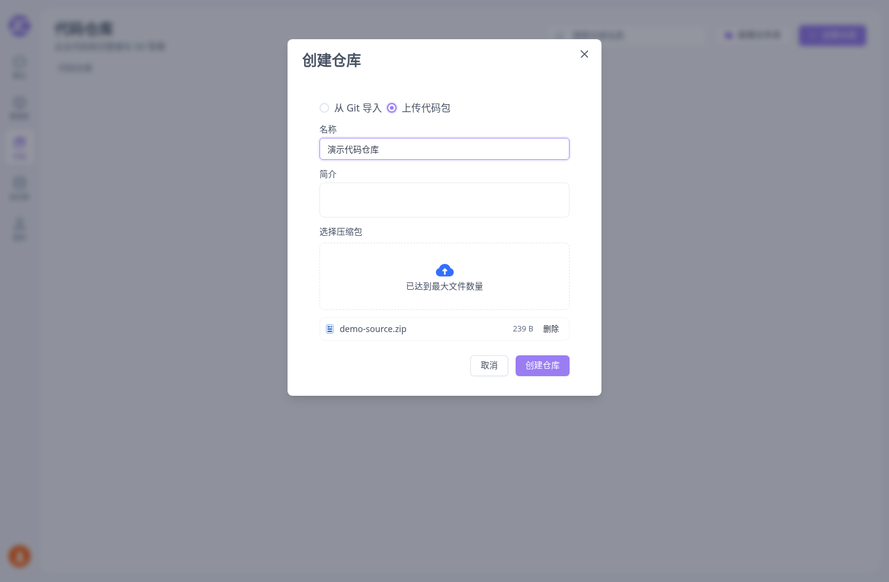

## 创建代码仓库

1. 确认当前团队，从左侧进入「代码」，打开目标文件夹后点击创建。根目录创建需要团队的代码仓库创建权限；文件夹内创建还需该目录的写权限。
2. 选择「从 Git 导入」或「上传代码包」。Git 导入填写部署环境可访问的仓库地址和分支，私有仓库按提示提供具备读取权限的凭据。离线环境可选「上传代码包」，支持 ZIP 或 TAR.GZ。
3. 等待上传或同步，然后进入仓库查看索引状态。图谱和语义索引有各自的状态；需要语义问答时，检查配置的向量模型是否在当前团队可用。
4. 从文件列表打开关键文件确认分支及版本。更新上传型仓库时使用「上传新版本」，提交包含完整源码的新压缩包。新包缺少的旧文件会随替换移除。Git 仓库按需要运行同步。

## 查询和核对

1. 从仓库详情选择源码、图谱或问答。用真实函数名和文件线索提问，例如「登录配置在哪里读取，配置缺失时会怎样」。
2. 展开回答的代码引用，核对路径、行号和实际调用关系。图谱用于快速理解关系；需要确认参数、常量和分支时打开原文件。
3. 如果使用智能体或工作流查询代码，先用业务成员账号确认仓库可见、模型可选，再验证一次正式入口中的引用。

## 授权、排查与版本更新

- 在仓库或文件夹的「权限」入口添加协作者，按读、编辑或管理职责授予。团队权限和资源权限的区别见[角色矩阵与权限分配](../account/permissions.mdx)。
- **看不到仓库**时核对当前团队、上级目录和仓库协作者。**看得到却不能同步或上传新版本**时检查仓库的写权限。
- **Git 导入失败**时核对仓库是否对部署服务器可达、分支是否存在、凭据是否有读取权限。离线现场可改用完整代码包。
- **问题找不到证据**时检查索引是否就绪、源版本是否正确、相关配置的模型是否可用。切换向量模型后按页面提示处理已有语义索引，重建完成后再验证相同问题。
