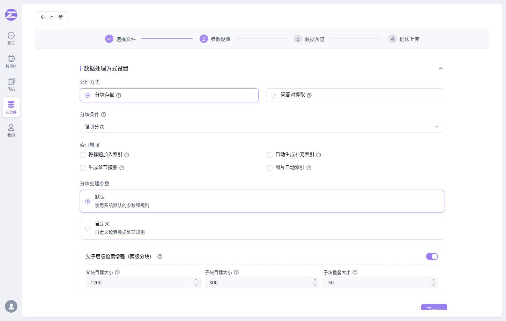
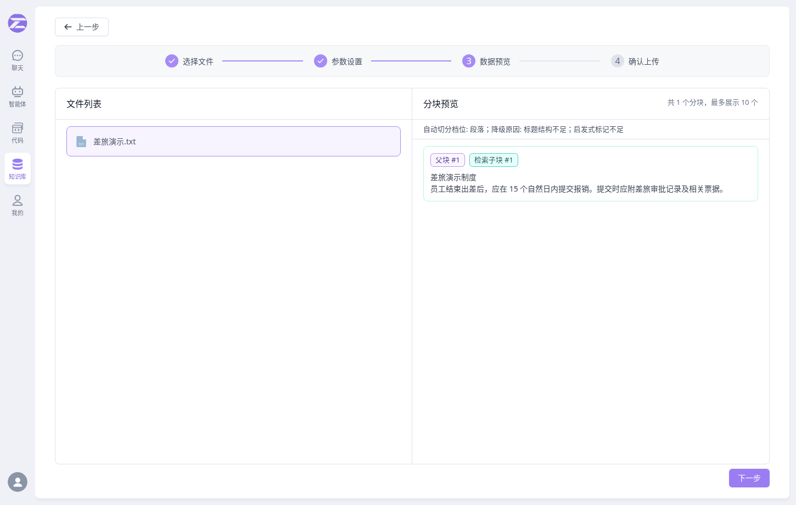

## 上传前

在「知识库」创建或打开一个「通用知识库」，确认当前团队以及知识库的索引模型。模型负责计算索引并用于查询，文件处理模型用于需要模型参与的解析和增强，视觉模型用于受支持的图片理解场景。可用类型和入口取决于本次部署的配置及授权。先用少量资料验证，再批量导入。

## 在数据集里导入

1. 打开知识库详情的「数据集」，依次点「新建/导入 → 文本数据集」，选择「本地文件」并确认。确认文件名、版本和上传状态。上传成功表示已收到文件。
2. 点击「下一步」，在「参数设置」设定文件解析和数据处理方式。启用了增强 PDF 解析的环境才会显示相应入口；扫描件或复杂表格可单独取样比较解析结果。
3. 在「数据预览」点击左侧文件。在显示的分块中抽查开头、中间和结尾。核对标题层级、段落、数字与单位，以及页眉页脚是否混入。预览异常时返回配置重试。
4. 确认导入，回到数据集跟踪解析、分块和索引的进度。查询前按[训练状态与索引](./training.mdx)验收。

## 如何选分块参数

| 设置 | 适用范围与检查方法 |
| --- | --- |
| 按标题层级 | 适合层级明确的制度和技术手册。检查标题路径，并观察超长章节有没有继续分段 |
| 按段落、长度或分隔符 | 适合普通说明、日志、固定格式记录。保留一条业务规则的前提、正文和例外在可读范围内 |
| 自动切分 | 适合先用样本找到合适策略。预览时重点看短条款有没有过碎、长清单有没有混到其他条款 |
| 按句切分 | 可由模型建议句间边界，适合结构差的资料。先观察耗时与效果，再决定是否用于批量导入 |
| 父子层级检索增强（两级分块） | 子块负责定位，父级上下文帮助补全同一章节的前提和例外。预览时看同一节切出的子块及其上下文 |
| 向量索引计算窗口 | 影响用于向量化的内容长度，和返回正文范围分别检查 |
| 补充索引、父块摘要、图片自动索引 | 按场景开启。检查处理模型的权限、用量和排队状态，并对比增益 |

从[快速上手](../quick-start.mdx)取一份差旅示例。让「报销期限」「提交材料」两条事实可独立找回。保留同一份样本的两种参数和检索结果，每次只改一个参数。

## 常见问题

- **预览中金额或表格不对**：先解决解析质量。阈值和重排无法恢复丢失的原文。
- **文件上传成功但搜不到**：查看数据集是否仍在处理，再核对检索范围和相关度。
- **准备更换索引模型**：先检查在途任务和现有索引，再按页面指引处理模型与索引的一致性。
