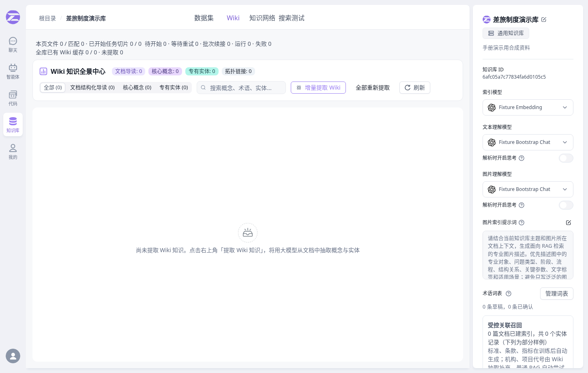

## 从知识库进入

在库详情打开「Wiki」。普通分块与索引就绪后，使用有写权限的账号发起提取。先验证模型可用，取几篇相关文档做小样本。

1. 点「增量提取 Wiki」，处理新增、未完成和失败的资料，保留已完成结果。追加文件后按需要再发起增量。
2. 等待后台任务。页面的「全库已有 Wiki 缓存」「未提取」按文件计；「已开始任务切片」只描述已经启动的任务。排队、运行和失败可同时出现。
3. 搜索一个术语，打开条目看摘要、别名、原文证据和来源文档。回到引用原文核对结论。看到旧缓存缺失证据或原文已变更的提示时，安排重新提取。
4. 需要更新全部文档的结果时用「全部重新提取」，例如更换抽取配置后统一生成。先核对模型权限、用量和任务状态。「生成导读」属于单独的后台操作。

## 在知识网络中定位

从 Wiki 条目可进入「知识网络」定位关联内容。图上的关联用于帮助定位资料；对时间、阈值和条款仍以原文为准。普通知识库检索会按系统规则尝试受控关联召回；Wiki 展示用的共现连线不直接充当普通检索的证据。想看某次搜索实际保留了什么，在[检索测试](./search-test.mdx)检查命中片段或详情。

## 常见问题

- **数据集已完成，但 Wiki 看起来是空的**：确认是否发起了抽取，检查是否排队、失败或搜索范围过窄。
- **新增一篇文件后旧条目还在**：查看增量目标与来源，检查是否有失效提示。先按原文确认，再选择增量或全部重新提取。
- **想从智能体跨文档追问概念**：先核对本库的 Wiki 条目和原文，再选择[维基问答](../agent/scenarios.mdx)并绑定本库。
